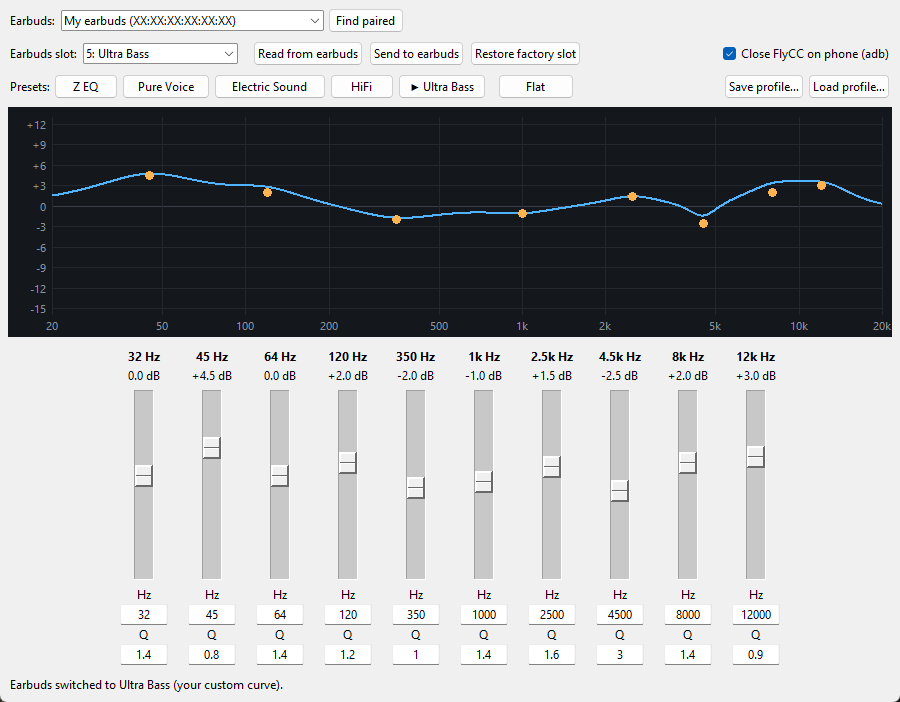

# AiroEQ

Custom parametric EQ for Airoha-based earbuds, written straight to the device.

The FlyCC app only offers fixed presets (Z EQ, Pure Voice, Ultra Bass…). The earbuds themselves run a full parametric EQ, so AiroEQ lets you set each band yourself and saves the curve into one of the five preset slots. You then pick that preset as usual, in FlyCC or on the earbuds.

## Features

- 10 bands with gain slider, frequency and Q, and a live response graph
- Preset buttons switch the earbuds' preset instantly and show the stored curve
- Writes to both earbuds and verifies by reading back
- Automatic factory backup before the first write, one-click restore
- Save and load your own profiles

## Requirements

- Windows (tested). Linux should work but is untested. macOS is not supported yet (Python has no RFCOMM sockets there).
- Python 3.9+ with Tk, and `pip install -r requirements.txt`
- The FlyCC Android APK: AiroEQ reads Airoha's PEQ library (`libnative-peq.so`) from it on first use, since the library is not included here

## Quick start

1. Download the zip from [Releases](https://github.com/mkaflowski/AiroEQ/releases/latest) and unpack it.
2. Run `pip install -r requirements.txt`.
3. Pair the earbuds with your PC. Close FlyCC on the phone, because it holds the connection. The *Close FlyCC on phone (adb)* option can do this for you.
4. Start `AiroEQ.bat` (Windows) or `AiroEQ.command` (macOS), click **Find paired** and pick your earbuds.
5. Set the bands, choose a slot and click **Send to earbuds**. On the first send AiroEQ asks for the FlyCC `.apk`.

Command line: `python race_tool.py --help` (for example `python race_tool.py peq 5 60:4:0.8 3000:-2:2`).

## How it works

AiroEQ talks to the earbuds over Bluetooth SPP using Airoha's RACE protocol. Each preset is an NVKEY holding biquad tables for 44.1 and 48 kHz. Coefficients are computed by Airoha's own library, run in a [Unicorn](https://www.unicorn-engine.org/) ARM64 emulator, so the results match the official app byte for byte.

Tested with FlyCC S62 earbuds (Airoha AB1562E). Other Airoha devices may use different keys.

## Disclaimer

AiroEQ is an unofficial project, not affiliated with Airoha or FlyCC. It writes to your earbuds' configuration, so use it at your own risk. **Restore factory slot** brings back the original curves.
